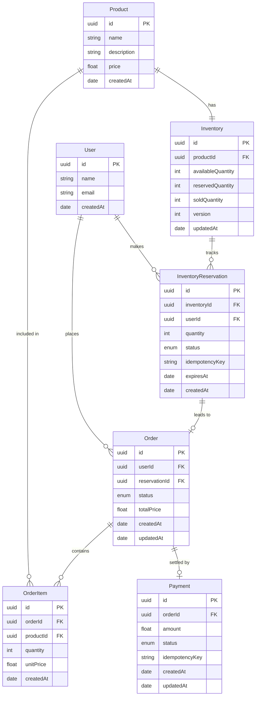
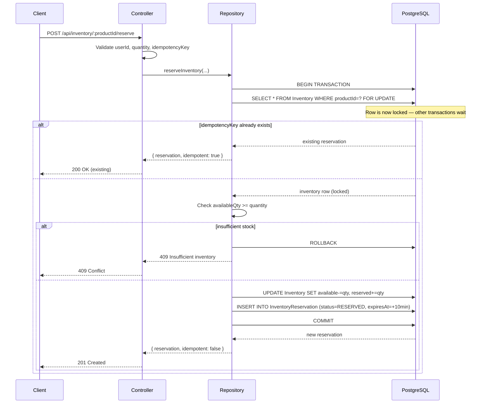
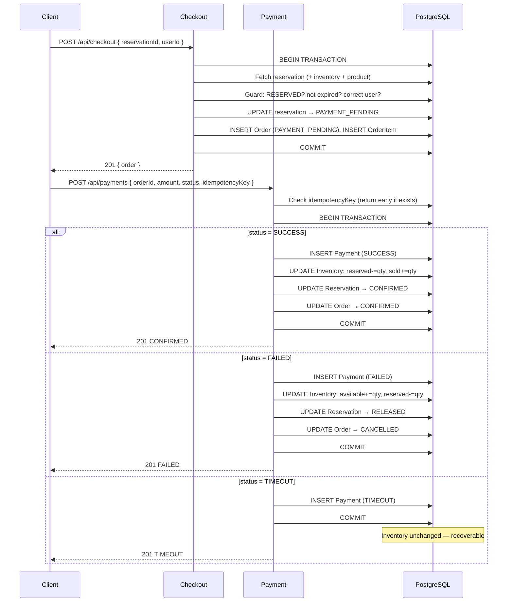

# SALESTORM Architecture

## 1. System Requirements

| Requirement | Detail |
|---|---|
| **Flash sale scenario** | 100 items sold to thousands of concurrent buyers |
| **Overselling** | Must be impossible — inventory never goes negative |
| **Duplicate requests** | Idempotent APIs — retries are safe |
| **Consistency** | Every inventory state change is atomic |
| **Recoverability** | Payment timeouts do not corrupt inventory |
| **Auditability** | Every reservation, order and payment is persisted |

---

## 2. High-Level Architecture

```
┌─────────────────────────────────────────────────────────────┐
│                         CLIENT LAYER                        │
│              React + Vite (localhost:5173)                   │
└─────────────────────┬───────────────────────────────────────┘
                      │ HTTP REST
┌─────────────────────▼───────────────────────────────────────┐
│                      API LAYER (Express.js)                  │
│  /api/products  /api/inventory  /api/checkout  /api/payments │
│  /api/reservations              /api/orders    /api/health   │
└──────┬───────────────┬──────────────────────────────────────┘
       │               │
┌──────▼──────┐  ┌─────▼──────────────────────────────────────┐
│  Service    │  │            Repository Layer                  │
│  Layer      │  │  product  inventory  order  payment repos    │
└──────┬──────┘  └─────┬──────────────────────────────────────┘
       │               │  Prisma ORM
┌──────▼───────────────▼──────────────────────────────────────┐
│                    PostgreSQL Database                        │
│   User  Product  Inventory  InventoryReservation             │
│   Order  OrderItem  Payment                                  │
└─────────────────────────────────────────────────────────────┘
```

---

## 3. Component Responsibilities

| Component | File(s) | Responsibility |
|---|---|---|
| **Routes** | `src/routes/*.routes.js` | Map HTTP verbs + paths to controllers |
| **Controllers** | `src/controllers/*.controller.js` | Parse/validate request, call service, send response |
| **Services** | `src/services/*.service.js` | Business rule enforcement |
| **Repositories** | `src/repositories/*.repository.js` | All Prisma queries; own transactions |
| **Error handler** | `src/middleware/errorHandler.js` | Central `(err,req,res,next)` formatter |
| **DB config** | `src/config/db.js` | Singleton PrismaClient |

---

## 4. Database / ER Diagram



---

## 5. Reservation Sequence Diagram



---

## 6. Order / Payment Sequence Diagram



---

## 7. Inventory State Flow

```
                    ┌─────────────┐
                    │  AVAILABLE  │  (availableQty = 100)
                    └──────┬──────┘
                           │  POST /reserve  (SELECT FOR UPDATE)
                           ▼
                    ┌─────────────┐
                    │  RESERVED   │  (available-=1, reserved+=1)
                    └──────┬──────┘
             ┌─────────────┼──────────────────┐
             │             │                  │
     release/expire    checkout          POST /reserve (409)
             │             │
             ▼             ▼
      ┌──────────┐  ┌──────────────────┐
      │AVAILABLE │  │ PAYMENT_PENDING  │  (no qty change)
      │(restored)│  └────────┬─────────┘
      └──────────┘           │
                   ┌─────────┼────────────┐
                   │         │            │
                SUCCESS   FAILED       TIMEOUT
                   │         │            │
                   ▼         ▼            ▼
            ┌──────────┐ ┌──────────┐ ┌──────────┐
            │CONFIRMED │ │AVAILABLE │ │RECOVERABLE│
            │sold+=1   │ │(restored)│ │(pending) │
            │reserved-=│ │reserved-=│ │          │
            └──────────┘ └──────────┘ └──────────┘
```

---

## 8. REST API Reference

| Method | Endpoint | Description |
|---|---|---|
| `GET`  | `/api/health` | Health check |
| `GET`  | `/api/products` | List all products |
| `GET`  | `/api/products/:id` | Get product + inventory |
| `POST` | `/api/products` | Create product + inventory |
| `PUT`  | `/api/products/:id` | Update product fields |
| `DELETE` | `/api/products/:id` | Delete if no active reservations |
| `POST` | `/api/inventory/:productId/reserve` | Reserve inventory (idempotent) |
| `GET`  | `/api/reservations/:id` | Get reservation |
| `POST` | `/api/reservations/:id/release` | Release a reservation |
| `POST` | `/api/checkout` | Create order from reservation |
| `POST` | `/api/payments` | Process mock payment (idempotent) |
| `GET`  | `/api/orders/:id` | Get order with items + payment |

---

## 9. Scalability Approach

| Concern | Current | Next step |
|---|---|---|
| **Lock contention** | Row-level `SELECT FOR UPDATE` per product | Partition inventory by product shard |
| **Throughput** | Single PostgreSQL instance | Read replicas for GET endpoints |
| **Queue** | Synchronous — request waits | Add BullMQ/Kafka to decouple payment processing |
| **Cache** | None | Redis for product catalog (read-heavy) |
| **Reservation expiry** | Client-driven (`expiresAt` stored) | Cron job / worker to sweep EXPIRED reservations and restore inventory |
| **Horizontal scaling** | Stateless Express — scale with PM2/Docker | Kubernetes HPA on CPU/RPS |

---

## 10. Security

| Area | Approach |
|---|---|
| **Input validation** | UUID format check + type guards in controllers |
| **Idempotency** | Unique DB constraint + early-return check |
| **SQL injection** | Prisma parameterized queries — no raw string interpolation |
| **Auth (future)** | JWT middleware on all mutating routes |
| **CORS** | `cors()` middleware; configure `origin` allow-list for production |
| **Rate limiting (future)** | `express-rate-limit` per IP + per userId |

---

## 11. Observability

| Signal | Implementation |
|---|---|
| **Errors** | `console.error` in `errorHandler` (replace with Pino/Winston) |
| **Version field** | `Inventory.version` increments on every write — audit trail |
| **idempotencyKey** | Links repeated requests to original response |
| **Timestamps** | `createdAt` / `updatedAt` on all entities |
| **Future** | Structured JSON logging, Prometheus metrics, Jaeger traces |

---

## 12. Failure Handling

| Scenario | Behaviour |
|---|---|
| **Reservation on empty stock** | `409 Insufficient inventory` — inventory untouched |
| **Expired reservation at checkout** | Status set to `EXPIRED`, `410 Gone` returned |
| **Payment FAILED** | Reservation → RELEASED, inventory restored, order → CANCELLED |
| **Payment TIMEOUT** | Payment recorded, inventory frozen in RESERVED — operator can retry or sweep |
| **Duplicate reserve key** | Original reservation returned (200), no DB write |
| **Duplicate payment key** | Original payment returned (200), no state change |
| **DB transaction abort** | Prisma rolls back atomically — no partial state |

---

## 13. Design Trade-offs

| Decision | Trade-off |
|---|---|
| **Pessimistic locking** (`FOR UPDATE`) | Serializes writes → safe, but limits throughput under extreme load |
| **PostgreSQL vs NoSQL** | ACID guarantees + relational integrity → harder to shard horizontally |
| **Synchronous payment** | Simpler flow → cannot handle long-running payment provider delays |
| **LocalStorage for user session** | Simple demo → not suitable for production (use JWT + httpOnly cookies) |
| **Monolithic Express app** | Easy to explain and deploy → harder to scale individual bottlenecks independently |
